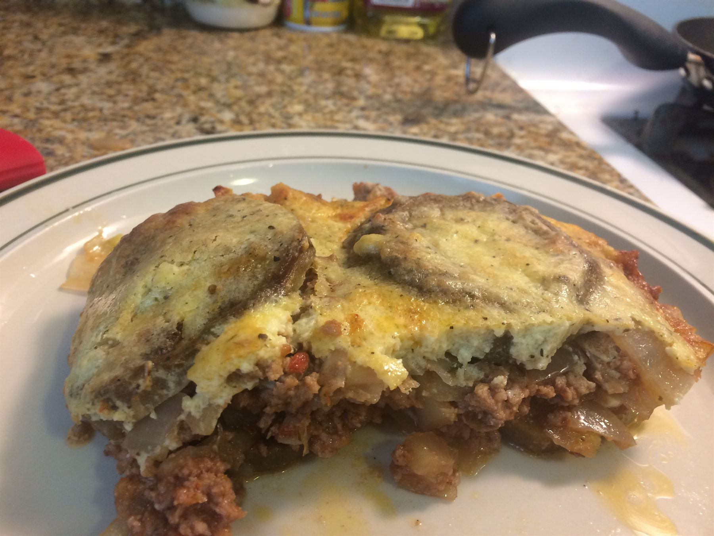

# Fairvopia

The cooking blog at [www.fairvopia.com](https://www.fairvopia.com), hosted on GitHub Pages.

The site is built with [Jekyll](https://jekyllrb.com/), which GitHub Pages runs automatically
every time you push. You don't need to install anything to publish.

## How the site is organized

| Where | What it is |
|---|---|
| `_recipes/` | One file per recipe. This is the only place you need to touch to add or edit a recipe. |
| `_layouts/recipe.html` | The shared page around every recipe: the menu bar, header image, footer and comments. Change it once and every recipe updates. |
| `index.html` | The home page: the globe over the main photo, then the filters, "What can I make?" search and recipe cards, all filled in automatically from `_recipes/`. |
| `_includes/` | Pieces the home page is assembled from (recipe cards, filters, menu bar, footer, recipe data). |
| `js/`, `css/` | The globe (`recipe-globe`), home page search and filters (`recipe-finder`), home page look (`home-layouts`), and the serving scaler, ingredient checkboxes and cook mode on recipe pages (`recipe-tools`). |
| `about.html` | The About & Contact page. (`contact.html` just forwards there so old links keep working.) |
| `img/` | All photos. |
| `_config.yml` | Jekyll settings. |

## Adding a recipe

Create a new file in `_recipes/`, for example `_recipes/moussaka.md`. It will be published at
`www.fairvopia.com/moussaka.html` and appear at the top of the home page and on the globe.
Start the file with a short header between two `---` lines, then write the recipe in two
sections, `## Ingredients` and `## Steps`:

```
---
title: "Greek Moussaka"
date: 2026-10-17
image: moussaka.jpg
location: "Athens, Greece"
country: "Greece"
coords: [37.98, 23.73]
type: main
time: 90
---

## Ingredients

- 2 eggplants, sliced
- 1 lb ground lamb
- 1/2 cup red wine

**Serves Four · Total Time: 90 minutes**

## Steps

1. Salt the eggplant slices and let them sit for 30 minutes.
2. Brown the lamb in a large pan.


```

Keep the `## Ingredients` and `## Steps` headings: the serving scaler, cook mode and the
"What can I make?" search all rely on them. Inside each section you can add smaller headings
such as `### Sauce` to split a recipe into parts. Start each ingredient with its amount
(`1/2 cup ...`, `2 eggs`, `1 1/2 tbsp ...`) so the scaler can change it.

The header fields are:

- `title`: the recipe name, shown on the page and in the browser tab.
- `date`: the date the recipe was posted (year-month-day). The home page is sorted by this.
- `image`: the photo in `img/` used as the big header image.
- `location`, `country`, `coords`: where the recipe goes on the home-page globe. `coords` is
  `[latitude, longitude]`, which you can copy from Google Maps by right-clicking a spot.
  `country` must be spelled the way the globe's country outlines spell it (for example
  `"United States of America"`, `"United Kingdom"`, `"South Korea"`) for that country to be
  shaded. A recipe without `coords` still shows up in the list but not on the globe.
- `type`: one of `main`, `soup`, `dessert`, `baking` or `side`, used by the filter buttons.

- `time`: total time in minutes, including waiting such as rising, soaking or chilling (for
  example `time: 90`). It's shown on the home page cards and used by the time filter and the
  "Quickest first" sort.

These fields are optional:

- `overnight: true`: the recipe also needs to rest overnight. It's shown as "+ overnight",
  sorted after the others, and left out of the "Under ..." time filters.

- `vegetarian: true`: shows the recipe under the Vegetarian filter.
- `list_title`: a different name to show on the home page, if it should differ from `title`.
- `favorite: true`: marks the recipe with a `*` on the home page and a gold pin on the globe.
- `hidden: true`: publishes the page but leaves it off the home page.
- `date_note`: extra text after the date, such as `"Updated January 2021"`.

Some older recipes have a time after the date (for example `2016-10-22 15:00:00`). The time
isn't shown anywhere. It only keeps recipes posted on the same day in the right order.

## Photos

Phone photos are large. Before adding one to `img/`, shrink it to about 1800 pixels on its
longest side (most photo apps can do this when exporting), which keeps pages fast on phones.

The home page cards use a small copy of each recipe's header photo from `img/thumbs/`, with
the same file name, about 640 pixels on its longest side. If a recipe has no small copy yet,
its card falls back to the full photo, which works but loads more slowly.

## Previewing locally (optional)

With [Ruby and Jekyll installed](https://jekyllrb.com/docs/installation/), run `jekyll serve`
in this folder and open http://localhost:4000.
